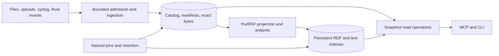

<!--
SPDX-FileCopyrightText: 2026 Blackcat Informatics® Inc. <paudley@blackcatinformatics.ca>
SPDX-License-Identifier: MIT OR Apache-2.0 OR MulanPSL-2.0
-->

# Sparrow architecture

This is the design contract for Sparrow's first implementation. It defines
required behavior, selected defaults, and qualification work. The implementation
and finite acceptance checks are complete; executable surfaces and runtime
evidence are recorded in [Development runtime](development-runtime.md).
Production capacity claims remain limited to the measured envelopes in the
[acceptance boundary](implementation-plan.md#current-acceptance-boundary).

The external contracts and examples are defined in [Interfaces](interfaces.md).

## 1. Goals and boundaries

Sparrow consolidates ephemeral diagnostic artifacts into a bounded store with
agent-oriented discovery, exact-byte inspection, and semantic queries. Its
implementation language is Rust. The first deployment is one Linux server with
local disks and initially under 10 GiB/day of uncompressed ingestion. Native
RocksDB and compression dependencies are acceptable.

The first version includes full JSON/JSONL and Markdown projection, structured
and unstructured logs, live syslog, file/API imports, completed-file consumption,
active-log tailing, named pins, MCP, CLI, and a Rust logging client. These ship in
the milestones below rather than as one undifferentiated implementation.

There is one global 30-day retention policy. Per-class retention, replication,
distributed queries, embeddings, an embedded language model, and a human
dashboard are outside the first version. Agents perform reasoning using evidence
and tools exposed by Sparrow.

Local sample locations supplied on 2026-10-06 include `/var/log`,
`~/Active/lillith_soul/inner-core`, and `~/Active/lillith_brainstem`. Bounded
read-only structural discovery is recorded in the
[implementation plan](implementation-plan.md). It does not establish complete
corpus coverage, repetition rates, size distributions, or peak ingestion rates;
those remain performance qualification work.

## 2. Responsibilities and data flow

| Component | Responsibility |
| --- | --- |
| PurRDF | RDF 1.2 identity and carriers; JSON and Markdown projections; SPARQL parsing, evaluation, results, and governors; text analysis and scoring. |
| Sparrow core | Artifact/record identity; sources and provenance; ingestion coordination; persistent storage adapters; retention, pins, recovery, and bounded operations. |
| Storage | Persistent catalog, exact bytes, manifests, references, RDF dictionaries/indexes, text postings, and import checkpoints. |
| Daemon | One storage owner; typed Cap'n Proto RPC ingestion and queries, syslog, watchers, worker scheduling, and operational metrics. |
| CLI / stdio MCP adapter | Clients of the daemon's typed operations. A stdio adapter does not open a competing writer on the database. |
| Rust client | Structured logging and upload transport with bounded buffering, explicit delivery state, and shutdown. |

Use the `purrdf` facade for semantic functionality. Use its native helper crates
when needed for storage primitives such as streaming content hashes. Do not
implement a second RDF parser, SPARQL evaluator, JSON-to-RDF converter, Markdown
slicer, tokenizer, or scoring law. Missing public integration seams are an
upstream integration task, not a reason to copy private implementation code.

The inspected local PurRDF baseline is `../purrdf`, commit `d80d072f88e1`, with
workspace version `3.0.1` and declared Rust MSRV `1.98`. These identify the design
baseline rather than an already resolved Sparrow dependency. Implementation must
record its exact dependency revision and supported Rust toolchain.

## 3. Logical model and identity

| Entity | Meaning |
| --- | --- |
| Artifact | One accepted complete file, dump, document, or upload. It has an occurrence ID, receipt time, media type, provenance, and an exact-byte payload/manifest. |
| Record | One addressable log event or JSONL entry. It has its own occurrence ID, source byte range, payload references, diagnostic fields, and projection state. |
| Source | A logical intake origin such as a configured watch, syslog listener, or client. It groups artifacts and stream generations without retaining their bytes indefinitely. |
| Stream | An ongoing source such as an active file or syslog/client stream. It describes provenance and ordering; it does not retain an unlimited byte history. |
| Payload | An exact byte sequence identified by its full BLAKE3 digest. It may be stored as a bounded value or through ordered chunk references. |
| Projection | Derived RDF or text facts, identified by content, codec/profile version, and all interpretation context. |
| Pin collection | A named set of artifact/record IDs with a finite deadline and its own stable ID. |

Occurrence identity and content identity are separate. Two identical diagnostic
events remain two records even when they share all payload and projection bytes.
Counts over occurrences must preserve that distinction. Source timestamps,
labels, and caller metadata belong to the occurrence envelope rather than
silently changing the content identity.

Artifact, record, source, stream, and pin IDs are opaque strings scoped to a persistent
`store_id`. Responses identify that store. Durable dictionaries may use compact
internal IDs; those IDs are never agent references or JSON numbers pretending to
be portable RDF identities. An ID minted by a PurRDF view is meaningful only in
that view's identity space.

Completed-file records inherit the artifact's acceptance time. Tailed records
receive their own acceptance time as they are committed. A completed file's
source modification time and a record's event time are independent metadata.
A record whose source profile yields no event time keeps its stored unknown
reason. Event-time reads place it at its receipt time, derived when read and
marked with basis `receipt`; a source instant has basis `source` and is never
replaced. Retention and expiry always use receipt time.

Large files use ordered manifests covering every original byte, including blank
lines, delimiters, CRLF, and a final unterminated record. JSONL/log boundaries
create addressable records; oversized records and opaque data use bounded byte
chunks. File identity includes the full original byte sequence, not a normalized
serialization. A partial upload or unfinished import cannot masquerade as a
complete downloadable artifact.

A record pin retains its byte range and minimal parent/source provenance. Once
an unpinned parent artifact expires, its complete manifest and unrelated records
may be reclaimed. The parent then describes an expired source with surviving
evidence; fetching it must not return the surviving subset as a complete file.
Whole-artifact pins preserve the complete manifest and its records. An agent
investigating an active stream captures currently retained record IDs; streams
are not complete-artifact pin targets. That selection does not implicitly pin
future appends or already expired bytes.

## 4. Storage decision

### 4.1 RocksDB and atomic ownership

Use one RocksDB database, operated by one serialized catalog writer, with bounded
parallel hashing, parsing, and query workers. Keep catalog, payload references,
pin membership, index publication, and source checkpoints in the same database.
Atomic write batches establish publication boundaries; the writer serializes
read-modify-write reference updates. [RocksDB basic operations](https://github.com/facebook/rocksdb/wiki/Basic-Operations).

Logical storage families cover control/catalog state, content/manifests,
references and expiry, pins, import checkpoints, the RDF dictionary and quad
indexes, and text facts/postings. Their encodings and the store format are
versioned. A newer unsupported format fails to open rather than being partially
interpreted. Raw evidence and provenance remain authoritative when a derived
index needs rebuilding.

Use integrated BlobDB on the payload family for larger values. Small records can
remain in compressed table blocks, where nearby values benefit from shared
compression. Enable blob garbage collection and observe its reclamation costs.
Blob storage relocates physical values; Sparrow's content IDs and references
must remain stable. [Integrated BlobDB](https://github.com/facebook/rocksdb/wiki/BlobDB).

Redb, SQLite, and filesystem-only compression were considered. RocksDB is the
initial choice because this design needs compressed persistent semantic indexes
as well as payload storage, and one publication boundary for its catalog. This
is an architectural choice to benchmark, not a demonstrated performance win.
Filesystems remain relevant for disk placement and hard quotas.

Intake must never wait on a stopped write path. Each family keeps four 32 MiB memtables,
so up to three can wait for a flush before RocksDB stops writes. Six background jobs give
one flush slot that never queues behind a compaction, and up to five compactions that
RocksDB starts only while level-0 files or pending compaction bytes call for a speed-up;
an idle store runs one. A level-0 compaction may split into two threads. Compaction
threads run at the lowest CPU priority, so on a host shared with other services they
yield to intake. The stated target is no hard stops and at most 1 percent of the time
stalled at the live write rate. Under the unit's one-core CPU quota the measured store
met it only once its compaction backlog had drained; the measurement is in
[load qualification](load-qualification.md#write-stalls-issue-160).

### 4.2 Deduplication and compression

Hash original bytes before content lookup. Deduplicate complete identical
payloads and manifests, including repeated records within different files. An
existing content entry gains references rather than another physical copy.
Verify stored content on reads used for integrity checks and recovery. Never
merge records solely because their normalized messages look similar.

Share projections only when content, codec/profile identity, document identity,
base IRI, and other interpretation inputs agree. Occurrence-specific metadata
and relationships are separate graphs. A new parser/profile version does not
reuse an incompatible projection.

Use LZ4 for hot table levels and Zstd for colder levels; use Zstd for payload
blobs. This is recompression during storage transitions, not an extra compression
wrapper around already compressed bytes. The default and payload families use
32 KiB table blocks and Zstd level 6 at the bottommost level; payload also trains
a 112 KiB dictionary there. The reverse lookup family keeps 4 KiB blocks and its
Bloom filter, because its point reads usually miss. The measured ratios are in
[load qualification](load-qualification.md#table-options-and-dictionaries-issue-19).
Startup must verify that requested codecs are available rather than accept a
silent uncompressed fallback: RocksDB refuses to open when LZ4 or the payload
blob codec is not linked, and a linked Zstd always supports dictionary training.
[Compression configuration](https://github.com/facebook/rocksdb/wiki/Compression).

New options apply only to new table files. The catalog key
`table-options-profile` names the profile whose files are all written. When it
differs from the running binary's profile, the default and payload families
are rewritten once by RocksDB's periodic compaction. Manual range compaction
does not fit this store: a range starts at the first level with keys in it,
so a level-0 file or memtable flush, which spans every catalog prefix, merges
the whole base level into every slice. A periodic job rewrites one marked file,
into its own level at the bottom or into its overlap one level down. The native
scheduler runs it below size-triggered compaction and aborts it when the store
closes.

The first step durably records the next table file number and a start second.
Every five seconds a serial maintenance step sets the two families' periodic
window to the seconds since the start, so only files created before it are
marked. The window starts after 60 seconds and moves only after drifting by a
minute or an eighth, which keeps native option writes rare. Files written in roughly the first eighth of the rewrite can be marked again and rewritten more than once; that adds work but does not delay completion. The step turns the
window off while pressure maintenance is outstanding. It also turns it off
while a job's 1 GiB of headroom would exceed the data allowance or leave less
than the free-space floor. When no file numbered below the recorded boundary
remains in those families, the profile key is written and the window is
turned off. A restart resumes from the recorded start. RocksDB reads files
written under either profile, so no store format fence is needed.

Reference counts cover manifest children, live occurrences, shared projections,
and pin-protected evidence. Term references include nested RDF terms. Garbage
collection removes data only after its complete reference closure becomes
unreachable. Deduplication ratios must count physical content once; logical
occurrence counts remain separate.

### 4.3 Budgets and reclamation

The deployment must supply a disk budget and a maintenance reserve. Thirty days
bounds age; it does not by itself bound bytes. Account for table/blob files,
journals, incomplete imports, dictionaries, indexes, old snapshot versions, and
compaction output. Distinguish live logical bytes from measured physical bytes.

Before accepting work, reserve its bounded staging and anticipated write space.
Run expiry and eviction, then bounded compaction/blob reclamation. Evict the
oldest eligible unpinned artifacts or stream records first. A protected record
survives eviction of its parent file. If reclamation lags, maintenance reserve is
insufficient, or pinned data occupies the available capacity, stop admitting
further writes and report storage pressure. Pins are never silently broken.

Recordless artifacts participate through a separate chronological catalog index.
Eviction merges it with the record timeline by receipt time and evidence identity
using native bounded cursors; queries retain their record-only timeline. Whole
artifact pins protect empty inputs. Index publication and removal share the
artifact's atomic boundary. Older stores build this required index through
durable finite upgrade pages after fencing earlier writers, and are not served
until the upgrade is complete.

Application accounting is an admission policy, not a hard guarantee about every
native engine allocation. A strict physical byte ceiling requires a configured
filesystem/volume quota. Reserve maintenance space below that ceiling and handle
quota errors as typed storage failures. Keep status reads and pin release
available while ingestion is backpressured. Admission reserves a bounded control
write allowance for pin release and recovery before filling the payload/index
budget. Actual storage failure can still refuse a control commit explicitly.

Bound all caches, worker queues, parser inputs, open imports, result handles,
read snapshots, and per-operation output. Independently measure process RSS and
engine/cache allocations; an internal byte counter is not an RSS measurement.

Qualify physical recovery through the existing RocksDB compaction and blob-GC
controls before asserting that a new binding API is necessary. The maintenance
worker must preserve pins, expose native failures and retain backpressure until
measured capacity allows the refused write again. Native scheduling alone does
not establish recovery. See [native reclamation](native-reclamation.md) for the
available controls and qualification evidence. Hard disk ceilings remain the
filesystem quota's responsibility.

### 4.4 Archive before delete

Sparrow keeps a 30-day searchable window of disposable logs. It can also
archive aged-out evidence to a large, slower store, such as a NAS, before
deleting it. The archive uses PurRDF's Parquet codec with N-Quads manifests, as
specified in [the archive format](archive-format.md). Archiving is optional and
configured by an `[archive]` table. Once a store has been fenced for archiving,
it never deletes unarchived evidence. That holds when the archive is down, while
it lags, and for the backlog present when archiving was enabled.

A durable watermark over the eviction order is the single deletion gate. Expiry
waits at it, and pressure eviction stops there with an `ArchiveLag` frontier.
Pressure then reports `AwaitingArchive` and keeps refusing data writes, because
safety comes before admission. Archiving starts early, at 75% of an entry's
retention or of the data budget, so the gate is rarely reached in normal
operation. Pins only delay deletion. Archiving ignores them, and an archived
pinned record survives until its pin ends. A dedicated archive thread performs
every NAS operation, one at a time, so a hung NAS degrades archiving without
blocking queries, ingest or maintenance. A store format fence keeps older
binaries away from an archiving store, and a clock-regression guard refuses
publication behind the watermark.

## 5. Retention and named pins

All deadlines are server UTC instants. One day means 24 hours, independently of
local time zones or daylight-saving changes. Initial retention is globally
`received_at + 30 days`.

At time `t`, an accepted occurrence is eligible when it has not been evicted and
either its ordinary deadline is after `t` or it is covered by an active pin whose
deadline is after `t`. Expiry uses `t >= deadline`. A file pin covers its records;
a record pin covers that record's dependencies. Arbitrary graph neighbors and
future query matches are not implicitly protected.

Pin names are case-sensitive store-local labels. Each active name identifies one
collection. Creating or adding members requires a positive integer day duration
and a concrete selection of currently live IDs. Validation is all-or-nothing:
missing, expired, or evicted targets refuse the mutation. Physically unreclaimed
bytes do not authorize resurrection of a logically expired record.

For `pin(name, targets, days)`, compute the requested deadline as `now + days`.
A new collection uses that deadline. An existing collection unions its members
and uses the later of its current deadline and the requested deadline. Repeated
calls cannot accidentally shorten protection. Renewal uses the same extension
rule; shortening is not a first-version operation. Return the actual deadline.

Reads never renew protection. Releasing a collection removes only that
collection's protection. Data younger than its ordinary deadline remains
eligible; expired data with another active pin remains eligible. An expired or
released name may be reused for a new collection with a new `pin_id`. Operations
on an old `pin_id` cannot mutate its replacement. Control metadata is itself
subject to cleanup and the storage budget, not an unlimited audit archive.

Serialize pin changes against expiry/eviction and acknowledge them durably. A
pin wins or fails at that publication boundary; cleanup cannot delete dependencies
of a successfully committed pin. Failed storage admission or commit does not
return a successful protection receipt.

New queries capture eligible membership at their start. Bounded read leases
preserve the physical versions needed to complete an operation, but do not create
investigation pins. Expiry affects subsequent queries immediately; physical
reclamation waits for those short-lived leases and native engine maintenance.
Report reclamation lag separately from logical expiry.

Metadata-only record, ranked-text and JSON key/value leases may stage their complete
immutable native summaries in bounded anonymous disk files under the same store
admission. These preserve page replay without retaining original payload or RDF
versions, creating pins or renewing retention. Their file allocation must be
charged even though directory enumeration cannot see it, and released with the
lease. Exact-byte reads remain independently subject to evidence eligibility.

Ordinary cleanup traverses catalog prefixes in finite passes rather than
collecting resident evidence. Each pass captures current pin protection under
the writer lock, admits complete record dependency retirement and bounded parent
manifest ownership, and advances its session-local seek position only after
durable publication. A completed traversal or reopen starts a fresh traversal;
new entries and changed protection behind a position are revisited then. Logical
eligibility always uses the current read instant, independently of this physical
cleanup schedule. Oversized indivisible catalog or record units fail explicitly.

## 6. Ingestion and recovery

### 6.1 Publication and durability

Ingestion has separate raw and derived states. Stream bytes into bounded content
batches and a recoverable import manifest. Publish a completed artifact only when
its exact-byte representation, provenance, references, and acceptance time are
consistent. Derived projection may run afterward. Tailed or syslog records
publish as independent record units.

Ordinary API/client ingestion may acknowledge `accepted` with `buffered`
durability. The default flush interval is two seconds; a durable mode and explicit
flush are available. It is an intended buffering interval, not a guarantee that a
failing disk will complete synchronization on schedule. Expose flush lag and stop
admitting buffered writes when the durability queue cannot remain bounded.

Keep the write-ahead log enabled. Pin success and source deletion require a
durable boundary covering their complete dependency set. For a large import,
chunk commits can precede the final publication; synchronize the final commit
and its preceding content before authorizing deletion. An acknowledgement that
only queued bytes or parser work is insufficient.

Parser failure, invalid UTF-8, or a projection limit does not discard an accepted
raw input. Preserve bytes and structured diagnostics. Expose pending, failed, and
partial projection coverage. Derived-index rebuilds must be possible from live
raw evidence; after only a record survives, rebuild it using its retained
interpretation context and provenance.

### 6.2 Linux change detection

Use inotify as the primary local filesystem event source. `IN_CLOSE_WRITE`
identifies a writable close; `IN_MOVED_TO` identifies a publication candidate.
`IN_MODIFY` schedules appended-data reads and resets quiet-time checks. Use rename
cookies and file identity to reconcile movement. Read-only closes are not
completion signals. These event types are defined by the [Linux inotify
API](https://github.com/torvalds/linux/blob/master/include/uapi/linux/inotify.h).

Completed-file watches use `readiness=close_or_idle` by default: close/publication
candidates enter the configured quiet interval, and pre-existing files can
qualify through scan-observed stability under the same producer contract. The
default interval remains 30 seconds; zero permits prompt consumption after a
completion candidate. Observed reopen/write activity postpones the claim. A
close from one writer does not establish that every writer has finished, and
future reopen remains possible; event counting is not a writer-lock mechanism.

Install per-directory watches before scanning that directory, then reconcile
queued changes. Add and scan newly discovered/moved-in directories. Inotify is
not recursive. On `IN_Q_OVERFLOW`, restart, or lost coverage, mark the affected
watch state uncertain and reconcile rather than trusting missing events. Handle
`IN_IGNORED`/unmount by refreshing watch state. Remote filesystem changes and
mapped writes are outside complete inotify coverage. [Inotify semantics and
limitations](https://man7.org/linux/man-pages/man7/inotify.7.html).

Keep event queues, rename tracking, and scans bounded. Queue saturation or kernel
watch limits trigger visible reconciliation work; do not infer completion from
the resulting silence. Until that work finishes, destructive claims require
fresh stability/handoff evidence. Unsupported event coverage falls back to scans
within the completed-file producer contract; active tailing remains
non-destructive. Periodic rescans also cover missed discovery races. Coverage
was never lost, so a completed-file rescan keeps its kernel watches and each
tracked candidate's quiet clock, and adds only what discovery missed.
Validate the current file generation before acting on a path from an event.

### 6.3 Completed-file consumption

Each configured `consume` watch owns a directory subtree and its producer
contract. Producers publish finished regular files and do not append after
handoff; atomic publication by rename is preferred. Inotify close/publication
events supply readiness candidates. The configurable quiet timer and scan
fallback operate within that contract, not as proof that an arbitrary open file
is finished.

The consumer:

1. Discovers files using inotify plus bounded recursive reconciliation. Observes
   stable size and modification state for the quiet interval, default 30 seconds,
   and revalidates readiness before claiming the current file generation.
2. Reserves an import ID and journals the source identity. Claims the file by an
   atomic move into an excluded `.sparrow-inflight` directory on the same
   filesystem. Persists the claim and directory changes for crash recovery.
3. Streams the claimed file into content/manifests and checks its identity and
   stability through the read. A changing claim remains recoverable and is not
   deleted as successfully consumed.
4. Completes the exact-byte manifest and durably publishes its catalog entry.
   Parsing failures can accompany a successful raw import.
5. Deletes only the claimed source after that durable boundary, then records
   completion. If unlink fails, retain a retryable deletion state.

A new file at the original path is a separate input and is never deleted on the
old claim's authority. Do not follow symlinks. Exclude claim directories and
Sparrow's own data from discovery, and reject overlapping watch roots in v1.

Recovery reconciles import journals with claim files. A crash before publication
resumes or retries the staged import; a crash after durable publication retries
deletion using the original import ID. An orphan claim is inspected and
reconciled, not discarded. One source generation cannot publish duplicate
occurrences on retry.

### 6.4 Active-log tailing

Each `tail` watch tracks source generation, file identity, committed byte offset,
and record boundaries. Checkpoint publication is atomic with its newly accepted
records. Reading bytes without committing them never advances the durable
checkpoint. Preserve an unfinished record across reads; finalize it at completed
handoff rather than dropping a final line without a newline.

Retain access to rotated generations long enough to drain them. A rotated file
can enter completed consumption after the producer has handed it off as finished
and it passes the quiet rule; explicit completion is also supported. A tracked
`IN_CLOSE_WRITE` helps establish readiness for a completed generation. A close
on the current append file triggers draining available bytes, but an unterminated
record remains pending until completed handoff. It does not change that watch's
tailing lifecycle or authorize deletion. Path replacement alone does not prove
the old writer has closed. Never unlink the current append file because it became
temporarily idle.

At completed handoff, drain to the final size and durably commit the generation's
terminal checkpoint before source removal. Reuse its claim/deletion journal;
do not re-import checkpointed events or refresh their acceptance times. Earlier
bytes that were durably accepted and then retired under retention remain retired.
Only advertise a complete downloadable file if its entire byte cover is still
retained; otherwise expose stream provenance and surviving records. Unresolved
capture gaps prevent automatic source removal until a completed-file import has
captured the remaining source representation.

Truncation or unexpected identity discontinuity starts a new generation with
known or possible gap evidence. Expected rotation with a drained old generation
preserves continuity.
Bytes overwritten or truncated before observation cannot be reconstructed. Do
not claim lossless capture for arbitrary copy-truncate producers; use completed
handoff or rename rotation when continuous capture is required. Stream metadata
does not keep expired record bytes alive forever.

### 6.5 Cap'n Proto, structured logs, and syslog

Use bounded streaming uploads and batches with retry identities. A client retry
of the same committed request/import reuses its occurrence IDs; a genuinely new
event with identical bytes receives a new occurrence. Backpressure is explicit,
with retryability and delivery state distinguishable from parser diagnostics.

The daemon transport is Cap'n Proto RPC over a private Unix-domain socket and
a public TCP socket, as directed on 2026-10-08. The selected public binding is
`0.0.0.0:518`; ingestion does not require authentication, while reads, queries
and administration over TCP require a shared-secret CHAP session. CLI, Rust clients and the stdio MCP adapter use the same
generated schema. Requests, binary payloads, instants, integer counts, receipts
and failures use typed fields and unions. No HTTP or JSON operation envelope is
used between clients and the daemon. Durability comes from atomic storage
publication and synchronization. A connection failure before a receipt leaves
delivery unknown and requires a stable retry.

Support modern RFC 5424 and legacy RFC 3164 syslog messages. TCP listeners use a
configured RFC 6587 framing mode; octet counting is preferred. UDP ingestion is
optional and reports drops, truncation, and malformed messages without promising
acknowledged delivery. Preserve raw messages. Do not silently invent a year or
time zone for an ambiguous legacy timestamp. Durable receiver positions describe
commit order and classified local discards separately from sender sequences;
sender/network/kernel and pre-commit continuity remain unknown. Finite receiver
summaries never extend raw retention and are not renewed by evidence pins.
[Syslog messages](https://www.rfc-editor.org/rfc/rfc5424.html),
[TCP framing](https://www.rfc-editor.org/rfc/rfc6587.html).

## 7. Graph and text query storage

Use complete PurRDF JSON and Markdown projections with explicit named profiles
and vocabularies. JSONL is projected record by record so file size does not imply
one unbounded resident dataset. A JSON record preserves duplicate keys, order,
number spelling, escapes, and byte spans under the shipped JSON law. Its raw
lexical scalar values are not silently converted into typed numeric literals.

Sparrow owns the vocabulary `urn:sparrow:vocab:` for occurrence metadata,
diagnostic facts, and relationships. Shared content graphs and occurrence graphs
are distinct. A record links to its content projection rather than duplicating
every content triple. The `eventTime` predicate carries only a source instant; a
receipt-time fallback uses the distinct `eventTimeFallback` and `eventTimeBasis`
predicates. Source, service, severity, event time, and trace/span
identifiers are normalized into a separate diagnostic view when available;
conflicting or ambiguous mappings produce diagnostics and preserve source
spelling.

Implement a storage-backed `DatasetView`/`FallibleDatasetView` over an immutable
RocksDB read snapshot. Persist forward/reverse term dictionaries and indexed quad
streams; resolve terms through bounded guards/cache entries. Reverse lookups
live in their own `rdf_reverse` column family with a whole-key Bloom filter:
they are the dictionary's only point reads that usually miss, and a filter over
the much larger scanned index keys would cost far more memory. Opening a store
moves any reverse lookups an older writer left in the default family, one
atomic page at a time, and older writers cannot open a store with this family. Preserve blank-node
scope, language and base direction, nested triple terms, graph declarations,
reifiers, and annotations. Keep each native RDF stream distinguishable and
advertise only capabilities the backend actually preserves.

Index subject-, predicate-, object-, and graph-bound probes without decoding all
retained data. The initial physical index set is `SPOG`, `POSG`, `OSPG`, `GSPO`,
`GPOS`, and `GOSP`, with a stream discriminator for primary, reifier, and
annotation rows. These are storage encodings, not changes to RDF semantics.
Measure their write and space costs; subsequent physical changes must preserve
the view contract and qualify against the same corpus.

Each graph declaration `rdf:g:<graph><owner>` has an owner-to-graph mirror
`rdf:o:<owner><graph>`. The same writer puts and deletes both rows in one batch,
so ingest, retirement and pin expiry keep them equal. A read whose scope is
narrower than the whole live store (a selection, a pin, or a live scope with a
source, receipt-time or diagnostic filter) evaluates every pattern per in-scope
graph. It enumerates the graphs from `rdf:o:` for each captured owner, then seeks
each graph in the graph-leading twin of the store-wide plan: `GSPO` for `SPOG`,
`GPOS` for `POSG` and `GOSP` for `OSPG`. The twin's tail after the graph is the
store-wide order, so a heap merges the per-graph cursors into that one global
order and keeps union-default deduplication. Unbound patterns and named-graph
enumeration use the same owner walk. Requests and row visits are charged as on
the store-wide plan, but only rows of in-scope graphs are read, so a scoped
read's cost follows its scope. A read over the whole live store keeps the
store-wide plan, whose cost is the store's. Opening a store written before the
mirror fences older writers and serves at once; the maintenance worker builds
the mirror from the existing declarations in resumable pages. Until the build
completes, every scope keeps the store-wide plan filtered to its owners, which
returns the same rows, and new declarations get their mirror rows as they are
written.

Online store migrations rebuild derived rows while the daemon serves. The open
applies the writer-format fence and seeds each migration's checkpoint durably,
then serves. The joined maintenance worker runs one bounded page per admission,
fairly with its other duties, and each page commits its rows and checkpoint
atomically through the ordinary write path, so a restart resumes after the last
committed page and a failed page is retried, never skipped. Readers take an
explicit pending path until a migration completes and say so where the answer
could differ: the schema 69 receipt-time fallback backfill is reported in
SPARQL coverage while the view serves the facts it still owes, scoped SPARQL
reads the owner index for the declarations already copied and walks the rest,
the source listings add what the source-summary migration still owes to the stored rows,
and record context walks the primary time index while a stale source timeline
cache is rebuilt. Pending paths that may read much of the store run from a
snapshot without the writer lock and check cancellation; their CPU is not
capped, they spend no request or visit budget, and what they hold is charged as
memory. No read refuses because a migration is unfinished. `status` reports
each migration's progress. A query-only
daemon runs no maintenance worker, so it serves on the pending paths. Writers
come before pages: before a page the maintenance worker waits while an ingest,
publication or RPC write is waiting for the writer lock, for at most the longer
of 100 ms and the previous page's hold, so the migration keeps progressing
without holding writers behind a run of pages. The worker polls that wait with
its other duties, so it delays only the page.

`status` and the migration report never take the writer lock. They read fixed
`store-counter:` rows from a RocksDB snapshot: the record, retained-record,
artifact, graph-declaration, record-graph, payload-chunk and JSON-projection
counts, and each migration's done count. One owner observes every write batch
and adds the row changes to it, counting created, deleted and evicted keys and
the keys a checkpoint move passes, so the rows are exact and crash-consistent
with the writes they follow; a count that would go negative or a missing row
refuses the write. Live records keep their deadline meaning: expiry marks a
record retired in the batch that retires its evidence, so a record past its
deadline counts only until that expiry pass, or while the archive gate holds it. The first online migration,
`store-counters`, seeds the rows of an older store in pages that only advance
its checkpoint; until it completes, those readers report the counts as pending,
exact through its watermark, and recount nothing, so status costs the same at
any store size. Pressure, rewrite and durability state reach status as a small
copy the writer publishes when a change ends, so status never waits for a pass
that holds that state across commits. Read-lease handle counts come from a ledger beside
each listing registry, so status never waits for a registry that a listing holds
while it waits for the writer.

Source and artifact discovery read three derived catalog row families instead of
the record catalog:

- `source-summary:<source key>` holds a source's label and its exact
  `retained_records`, `complete_artifacts` and `fragment_parents` counts;
- `artifact-retained:<artifact id>` holds an artifact's retained record count,
  marked full, or partial for a parent whose entry was deleted before the
  seeding migration reached it, while the artifact is listable;
- `source-artifact:<source key>:<receipt>:<artifact id>` is the per-source
  artifact index, ordered by receipt time within each source.

The source key is the BLAKE3 hex of the exact source label, shared with the
source record index. One owner observes every catalog write batch and adds the
row changes to the same batch, so no writer can change a record or artifact
entry without them; a count that would go negative or a missing row refuses the
write. `sources` reads one counter row per source from a snapshot taken under
the writer lock and released before reading, and the live artifact listing walks
the index of the selected sources, so neither costs the size of the store. The
online `source-summary` migration seeds the rows of an older store; until it
completes both listings add what the migration still owes, computed by its own
counting passes over a snapshot, once per `sources` capture and once per window
of owed rows a live artifact listing reaches, and answer as they will after it.
Each pass runs as a listing build on its own thread: a call waits for it at most
5 seconds, and until it finishes answers with no rows, the build's cursor and
its progress, so no page outlasts a caller's deadline.

Use PurRDF's governed prepared queries and fail-aware execution boundary.
Storage faults refuse publication of an apparently successful prefix. Governor
outcomes preserve the engine's certainty certificate: certain answers,
at-most candidate sets, and unknown outcomes are different evidence. Do not
present possible candidates as proven answers. Index coverage is independent of
execution certainty; an exact query over ready data may still exclude pending
projections in its selected source set.

Persist text facts, postings, and corpus statistics using PurRDF's analyzer and
ranking profiles. Its ordinary `TextIndex` is resident; do not rebuild the full
retention window into it for each search. Use the public analysis and
`PreparedCorpus`/`PreparedQuery` scoring seams for Sparrow's stored postings.
Scores identify their corpus/scope and profile. Different scopes' raw scores are
not directly comparable; any combined ranking uses an explicit PurRDF retrieval
fusion policy. Store-backed full-text SPARQL relations use its public extension
seams and caller-selected IRIs.

## 8. Qualification, metrics, and milestones

### Acceptance scenarios

| Area | Required scenario and result |
| --- | --- |
| Bytes and projection | Retrieve exact JSON, Markdown, JSONL, CRLF logs, blank lines, binary input, and final unterminated records; validate native projections against PurRDF. |
| Deduplication | Repeated input shares physical content/projections but preserves occurrence counts; expiring one reference does not delete another's evidence. |
| Semantic backend | Compare representative stored-view queries with the resident PurRDF view, including cross-record joins, blank scopes, direction, triple terms, reifiers, annotations, and empty graphs. |
| Retention | Use an injected clock to exercise the exact 30-day boundary; queries exclude expired entries while physical reclamation can lag. |
| Pins | Exercise named creation, addition, renewal, overlap, release, expiry, name reuse, and rejected expired targets; record pins survive parent expiry without retaining unrelated records. |
| Pressure | Evict oldest unpinned data; retain pins; backpressure when protected bytes or native reclamation prevent safe admission; keep status/release operations usable. |
| Archive | Never retire unarchived evidence by expiry or pressure; retire it after its segment commits; keep archived pins; refuse unconfigured fenced stores, older binaries and clock regression. |
| Consumption | Inject crashes before claim, mid-import, before publication, after durable publication, and around unlink; retain recoverability and avoid duplicate publication or deleting replacements. |
| Linux watching | Exercise writable/read-only closes, reopen after close, multiple writers, moved-in publication, files closed before startup, new subdirectories, queue overflow, watch exhaustion, and stale path events; reconcile without treating missing events as completion. |
| Tailing | Exercise append, unfinished records, rename rotation, completion, truncation, inode/path changes, and checkpoint recovery; expose observed gaps. |
| Tail completion | Finalize a generation after older records have expired without replaying events or renewing retention; do not claim a complete file from surviving fragments or remove a source with unresolved capture gaps. |
| Query evidence | Distinguish exact, certain, at-most, unknown, incomplete-index, paginated, and failed-storage responses consistently across MCP and CLI. |
| Client transport | Verify stable retry identities, buffered versus durable acknowledgements, bounded queues, visible drops, and flush/shutdown. |

These are the acceptance tests to implement with their features. Documentation
validation checks links, examples, type/operation consistency, and agreed defaults.

### Performance qualification

Establish baselines for sustained input and backlog bursts, full JSON/Markdown
projection, selective and broad queries, text search, and maintenance concurrent
with ingestion. Use synthetic fixtures first, then representative production
samples with recorded corpus fingerprints and size/repetition distributions.

Report accepted raw bytes and records per second; projection statements and
index bytes; end-to-end ingest/query latency distributions; process RSS and
bounded-cache use; physical bytes by component; whole-store compression and
deduplication ratios; write amplification; expiry/reclamation lag; and pin-held
bytes. Measure a simulated 30-day turnover, sparse and dense pins, incompressible
inputs, malformed records, and bursts large enough to trigger backpressure.

Publish hardware, filesystem/quota, build/dependency revisions, configuration,
corpus, measurement method, and whether the store was warm or cold. Raw payload
compression alone is not a whole-store density result. No throughput or density
target is claimed from preliminary sample discovery. Inaccessible inputs remain
an explicit corpus coverage gap.

Operational status exposes intake/drops, queue/flush lag, projection failures,
active import/checkpoint states, oldest retained time, live/physical/reclaimable
bytes, active pins, query refusals/certainty, and storage pressure. Monitor the
effective retained window when early eviction occurs.

### Implementation sequence

| Milestone | Deliverable and exit criteria |
| --- | --- |
| 0 — Definition | These three documents agree on types, lifecycle, defaults, and interfaces. No executable scaffolding is part of this milestone. |
| 1 — Storage and lifetime | Raw storage/retrieval, manifests, reference accounting, global expiry, disk admission, and durable named pins pass their acceptance scenarios. |
| 2 — Import | Cap'n Proto/file streaming, idempotent import journals, durable completed-file consumption, and restart recovery pass byte/deletion scenarios. |
| 3 — Query and agents | Native full projections, persistent graph/text adapters, coverage/certainty receipts, stdio MCP over the typed daemon client, and CLI pass semantic and interface comparisons. |
| 4 — Continuous producers | Syslog, active tailing, and the Rust `tracing` client pass framing, rotation, checkpoint, buffering, and delivery scenarios. |

Within milestone 3, prioritize the agent investigation surfaces: temporal and
field filtering, key/value discovery, full-text logs and JSONL, and bounded
context with exact-byte evidence. The [implementation plan](implementation-plan.md)
subdivides these deliverables without replacing the milestone acceptance gates.

Qualify each storage/index format before connecting a destructive watch to a
production directory. Use a copy of representative inputs for that qualification;
the later configured consume operation is the producer handoff authority.

### Design references

- [PurRDF backend contract](https://github.com/Blackcat-Informatics/purrdf/blob/main/docs/design/purrdf-backend-contract.md)
- [PurRDF persistent read sessions](https://github.com/Blackcat-Informatics/purrdf/blob/main/crates/rdf-core/STORAGE.md)
- [PurRDF JSON codec and measurements](https://github.com/Blackcat-Informatics/purrdf/tree/main/crates/json)
- [PurRDF Markdown codec](https://github.com/Blackcat-Informatics/purrdf/tree/main/crates/markdown)
- [PurRDF text ranking](https://github.com/Blackcat-Informatics/purrdf/tree/main/crates/text)
- [PurRDF query governor profile](https://github.com/Blackcat-Informatics/purrdf/blob/main/docs/SPARQL-GOVERNOR-PROFILE.md)

The inspected local revision above is the baseline for these references;
`main` links may evolve. Implementation qualification must use its pinned revision.
